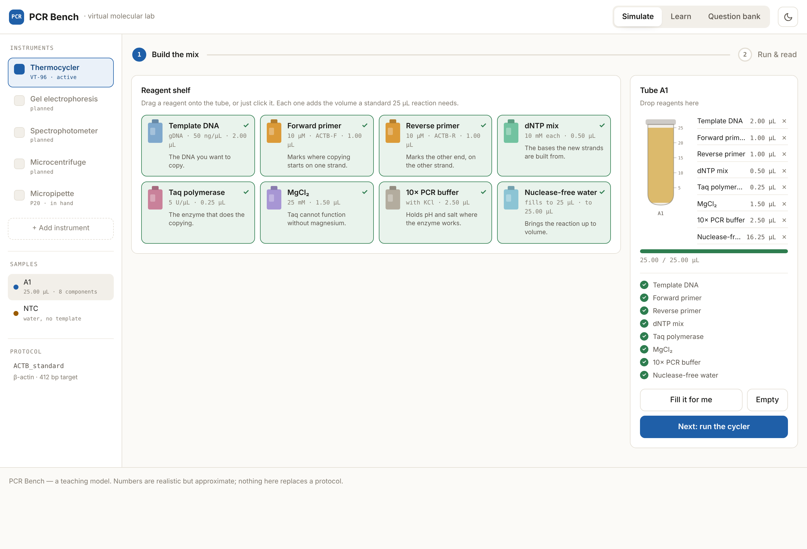
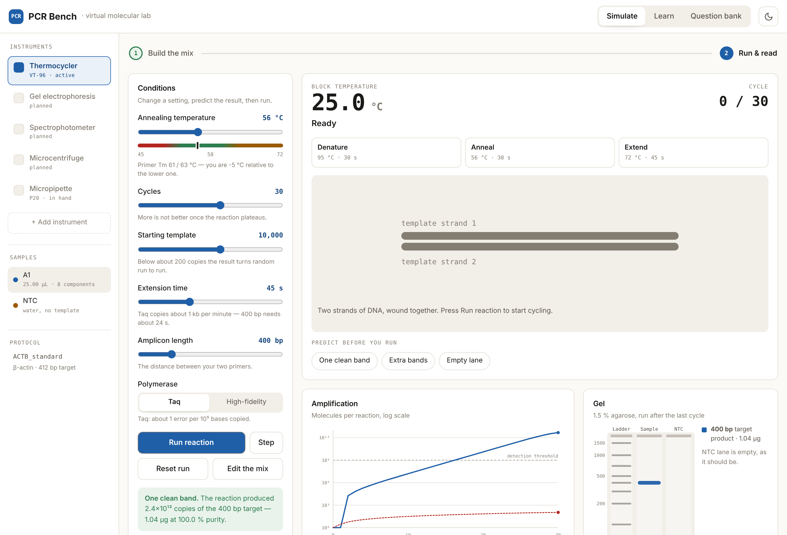
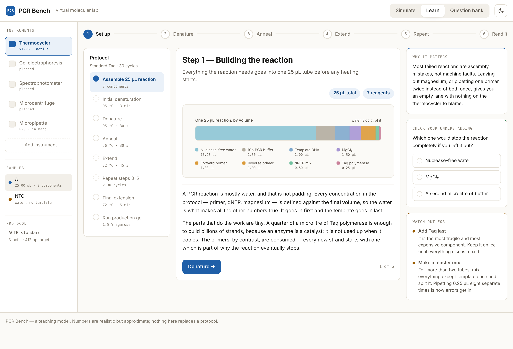

# PCR Bench

An interactive PCR simulator for students. Build the reaction by hand, run the thermocycler, read the gel, and find out why it failed when it does.

**Live site → https://vigneshseetharaman.github.io/pcr-bench/**

Built as a capstone project: a working PCR tool, and the shell for a virtual lab that more instruments can be added to.



---

## What it does

Three tabs.

**Simulate** — two stages. First you build a 25 µL reaction by dragging reagents from the shelf into the tube (clicking works too, which matters on phones and for keyboard users). Then you set the conditions and run the cycler: live block temperature, a molecular view of each step, an amplification curve on a log scale, and a stained gel with a ladder, your sample and a no-template control.

**Learn** — a six-step guided walkthrough of one PCR cycle, each step with its own diagram, a protocol checklist showing where you are, a "why it matters" note, a comprehension check and the common failure modes.

**Question bank** — 20 questions across five topics with explanations for every answer.



---

## What's actually simulated

This is not an animation with pre-set outcomes. The numbers come from a model that runs each cycle.

**Molecule pools.** The simulator tracks four populations separately: original template, ragged intermediates with one primer-defined end, fixed-length amplicon with both ends defined, and artefacts. Each cycle, every pool is copied with probability *E*. This reproduces the real result that fixed-length product first appears in cycle 3 and then grows as 2ⁿ − 2n while the ragged products only grow as 2n.

**Per-cycle efficiency** is derived, not assumed:

| Input | Effect |
|---|---|
| Annealing temperature vs. primer Tm | Full binding up to Tm − 4 °C, falling to zero by Tm + 6 °C |
| Annealing temperature, low end | Below Tm − 10 °C, mispriming rises; below Tm − 12 °C, primer dimers |
| Extension time vs. amplicon length | Scaled against Taq's ~1 kb/min; short steps leave strands unfinished |
| Reagents present | Missing components apply their real penalty (see below) |
| Total molecules | Capacity term drives the plateau at ~6 × 10¹² strands |

**Missing reagents fail the way they fail at the bench.** No Taq, no dNTPs or no MgCl₂ → nothing at all. One primer instead of two → linear copying, no band. No buffer → about 12 % efficiency. No template → the tube becomes a no-template control, and primer dimers still form in it. Under volume → every concentration is off.

**Stochastic below ~200 copies.** Early cycles are sampled per molecule rather than multiplied, so low-template reactions genuinely give a different answer each run. That is allele dropout, and it is the reason low-template forensic and single-cell PCR needs replicates.

**Real units throughout.** Yield is computed as mass (650 g/mol per base pair) and a gel band only appears above ~0.3 ng, with intensity scaled by mass. A reaction can make ten million copies and still show an empty lane — which is a lesson, not a bug.



---

## What it deliberately does not model

Worth stating plainly, because a simulator that hides its limits teaches false confidence.

- **No sequence.** It will not catch a primer that folds on itself, a hairpin in the template, or a GC-rich stretch the polymerase stalls in. Primer Tm values are fixed at 61/63 °C rather than calculated from bases you enter.
- **No real thermodynamics.** Binding is a fitted curve, not nearest-neighbour calculation.
- **No bench reality.** Bad reagent lots, a drifting block, samples left out too long — the things that actually ruin reactions — are absent.
- **No motor skill.** It cannot teach pipetting.

It is best used as pre-lab preparation, which is where the evidence for simulation efficacy is strongest. It is not a lab replacement.

---

## Running it

Nothing to install, no build step.

```bash
git clone https://github.com/VigneshSeetharaman/pcr-bench.git
cd pcr-bench
open index.html      # or just double-click it
```

The whole application is one self-contained HTML file. The only external request is the Google Fonts stylesheet; without a network it falls back to system fonts and everything still works.

To host it anywhere else, copy `index.html` to any static web server. GitHub Pages serves it from the repository root on the `main` branch.

---

## Project layout

```
index.html      the entire application — markup, styles, simulation model, content
docs/           screenshots used by this README
.nojekyll       tells GitHub Pages to serve the files as-is
```

One file is a deliberate choice at this stage: it can be opened from a USB stick, emailed, or dropped into any LMS without a toolchain. If the project grows past one more instrument, splitting the simulation model, the UI and the content into modules is the first thing to do.

Inside `index.html` the script is organised in labelled sections: tabs, instrument rail, reagents, tube/build UI, the model, formatting, chart, gel, tiles, stage animation, run control, lesson, and question bank.

---

## Adding another instrument

The instrument rail on the left is the extensibility story, and the `+ Add instrument` button is honest about what exists: the thermocycler is built, the rest are listed as planned.

A new instrument needs three things:

1. An entry in the `INSTRUMENTS` array (name, status, description).
2. A simulation function that reads the sample state the previous instrument produced and returns a new state.
3. A panel that renders its controls and results.

Gel electrophoresis is the natural second tool, because it consumes exactly what the thermocycler produces — the four molecule pools with their lengths and quantities. Building it is what would prove the shared sample model, rather than just asserting it. The gel currently drawn on the Simulate tab is a preview of what that module would own.

---

## Accessibility

Every reagent can be added by click or keyboard as well as by drag. Tab panels use proper `role="tablist"` semantics with arrow-key navigation. Colour is never the only signal — every state carries a label or a shape. The page works at phone width with no horizontal scroll, and respects `prefers-reduced-motion`. Theme is light by default with a toggle in the header, remembered per browser.

---

## Status and licence

Prototype, built for review. Figures are realistic but approximate and should be checked before any classroom use.

No licence is attached yet, because ownership of the project has not been settled with the supervising faculty. Until one is added, all rights are reserved — please ask before reusing it.
